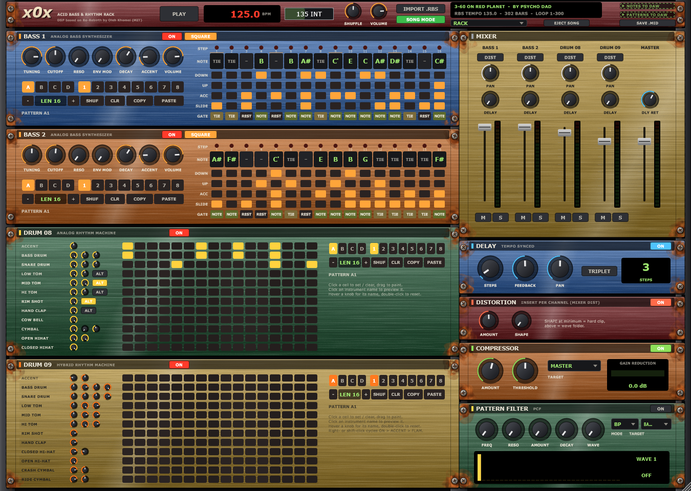
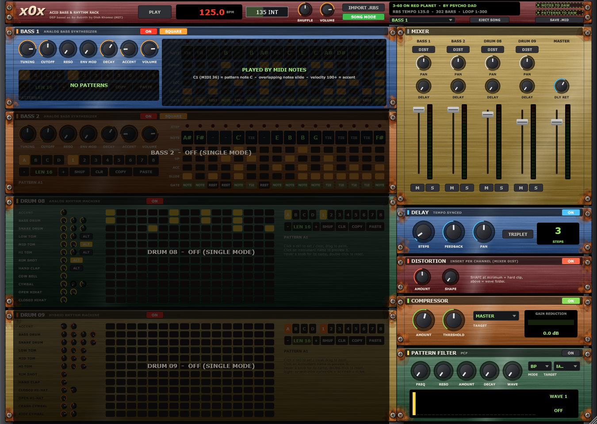
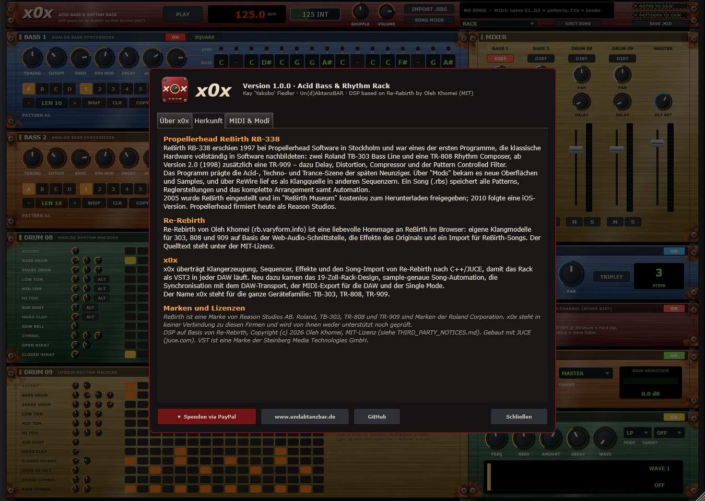

# x0x – Acid Bass & Rhythm Rack


Ein virtuelles Acid-Rack als **VST3-Plugin und Standalone-Programm** für Windows:
zwei 303-artige Bass-Synthesizer, die Drumcomputer **DRUM 08** und **DRUM 09**,
ein Pattern-Sequencer mit Host-Sync, Mischpult, Delay, Distortion, Compressor und
Pattern-Filter – eingebaut in ein 19-Zoll-Rack. Alte **ReBirth-Songs (.rbs)**
lassen sich direkt laden und spielen mit ihrem kompletten Arrangement.

Website: https://www.undabtanzbar.de/software/ – GitHub: https://github.com/Yakobo1970



## Download

Fertiger Windows-Installer (VST3 + Standalone, beides wählbar):
[**Neueste Version herunterladen**](https://github.com/Yakobo1970/x0x/releases/latest)

- VST3 → `C:\Program Files\Common Files\VST3\x0x.vst3`
- Standalone → `C:\Program Files\x0x\x0x.exe`

## Funktionen

- **2× Bass** im Stil der TB-303: Tuning, Cutoff, Resonanz, Env Mod, Decay, Accent,
  Säge/Rechteck, Slide, Tie, Accent pro Step
- **DRUM 08 / DRUM 09** im Stil von TR-808 und TR-909, mit Regler je Instrument,
  Accent, 909-Flam und Einzelaccent
- **Effekte**: Tempo-synchrones Delay, Distortion (pro Kanal einschleifbar),
  Compressor (Master oder Kanal), Pattern Controlled Filter mit 56 Wellen
- **Sequencer**: 32 Patterns je Gerät, Längen 1–16, Shuffle, folgt dem DAW-Transport
- **ReBirth-Import (.rbs)**: Patterns, Regler, Mixer, Effekte und das Song-Arrangement
  mit allen Pattern-Wechseln und Automationen; SONG MODE spielt es synchron zur DAW
- **Song-Automation** schreibt in die echten Plugin-Parameter zurück – die Regler
  bewegen sich mit und lassen sich jederzeit übernehmen
- **MIDI-Export per Drag & Drop**:
  - *NOTES TO DAW* – der Song als echte Noten (303 mit Slide/Accent, Drums auf
    GM-Noten) plus Regler-CCs, eine Spur je Gerät
  - *PATTERNS TO DAW* – Pattern-Wechsel + CCs für ein x0x im Rack-Modus
- **Single Mode**: nur ein Gerät klingt und wird über MIDI-Noten gespielt – ein
  x0x pro Gerät in der DAW, inklusive Mute, Editieren und fremder Synthesizer
- Komplette MIDI-Belegung: [MIDI_CC_MAP.md](MIDI_CC_MAP.md)



## Herkunft

**Propellerhead ReBirth RB-338** erschien 1997 in Stockholm und bildete zwei
Roland TB-303 und eine TR-808 in Software nach, ab Version 2.0 (1998) zusätzlich
eine TR-909. 2005 wurde es eingestellt und im „ReBirth Museum“ kostenlos
freigegeben; Propellerhead heißt heute Reason Studios.

**Re-Rebirth** von Oleh Khomei (https://rb.varyform.info) ist eine Hommage an
ReBirth im Browser, mit eigenen Klangmodellen auf Basis der Web-Audio-Schnittstelle
und einem Import für ReBirth-Songs (MIT-Lizenz).

**x0x** überträgt Klangerzeugung, Sequencer, Effekte und Song-Import von
Re-Rebirth nach C++/JUCE und ergänzt Rack-Design, sample-genaue Automation,
DAW-Synchronisation, MIDI-Export und Single Mode. Der Klang folgt Re-Rebirth sehr
genau, ist aber bewusst keine 1:1-Kopie des Originals.



## Entstehung

Idee, Konzept und Regie: **Kay 'Yakobo' Fiedler**. Umgesetzt mit **Claude
(Anthropic)** als KI-Programmierassistent – abgeglichen an Offline-Renderings der
Web-App und an 155 echten ReBirth-Songs.

## Selbst bauen

Voraussetzungen: Visual Studio 2026 (C++), CMake ≥ 3.22, JUCE-Quellen
(Standard: `%USERPROFILE%\JUCE`, sonst `-DJUCE_DIR=...`).

```bash
cmake -S . -B build -G "Visual Studio 18 2026" -A x64
cmake --build build --config Release --target x0x_VST3 x0x_Standalone
```

Installer: `"C:\Program Files\Inno Setup 7\ISCC.exe" installer\x0x.iss`

Werkzeuge in `Tools/`: `RenderTest` (Offline-Render und Regressionstests, u. a.
`transport-test`, `fx-test <rbs>`, `midi-roundtrip <rbs>`, `cc-map`), `HostTest`
(lädt das VST3 wie eine DAW), `UiShot` (rendert die Oberfläche und das Icon als PNG).

## Unterstützen

x0x ist kostenlos. Wer die Entwicklung unterstützen möchte:
[Spende per PayPal](https://paypal.me/yakobo) – vielen Dank!

## Lizenz und Marken

Eigener Code: MIT-Lizenz (siehe [LICENSE](LICENSE)). Klangerzeugung und Song-Import
basieren auf Re-Rebirth, Copyright (c) 2026 Oleh Khomei, MIT-Lizenz (siehe
[THIRD_PARTY_NOTICES.md](THIRD_PARTY_NOTICES.md)). Gebaut mit JUCE (https://juce.com)
unter dessen eigenen Lizenzbedingungen.

ReBirth ist eine Marke von Reason Studios AB. Roland, TB-303, TR-808 und TR-909 sind
Marken der Roland Corporation. VST ist eine Marke der Steinberg Media Technologies
GmbH. x0x steht in keiner Verbindung zu diesen Firmen.
